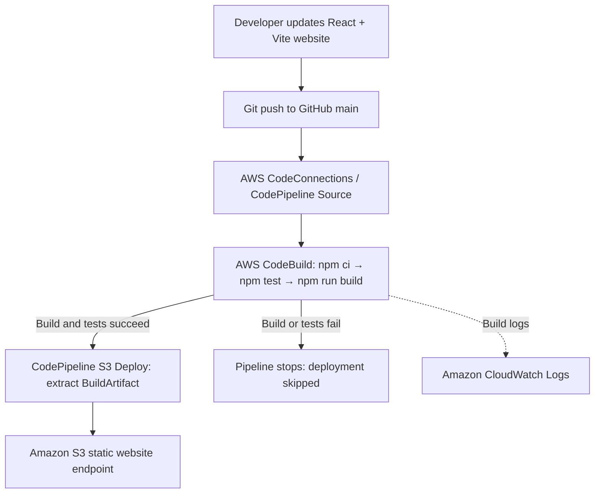
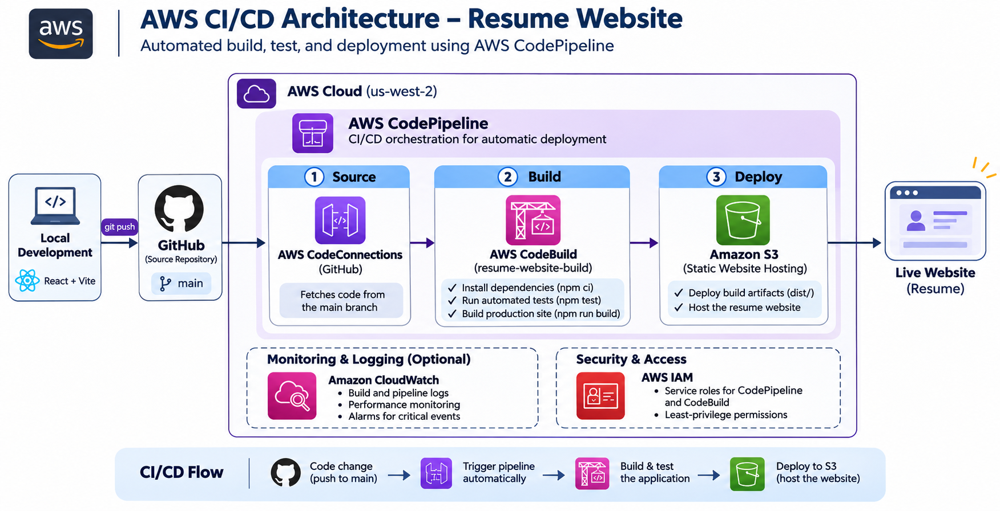

# React Resume Website — AWS CI/CD Pipeline

A responsive personal resume website built with **React and Vite**, version-controlled on GitHub, and automatically deployed to **Amazon S3** using **AWS CodePipeline** and **AWS CodeBuild**.

> **Repository:** https://github.com/WynnLe12/copm4964-resume  
> **Live website (HTTP):** http://wynnle12-resume-website-2026.s3-website-us-west-2.amazonaws.com  
> **AWS Region:** `us-west-2` (US West — Oregon)  
> **Note:** The S3 static website endpoint supports HTTP, not HTTPS. HTTPS would require CloudFront or another HTTPS frontend.

## 1. Project overview

This project demonstrates continuous deployment: pushing changes to the GitHub `main` branch triggers CodePipeline to fetch the source, build the React application, run automated tests, and publish the production assets to an S3 bucket. The website contains resume and portfolio information.

## 2. Architecture



**Pipeline stages:** **Source → Build → Deploy**. Automated tests run inside the **Build** stage using `npm test`; there is **no separate Test stage**. The Build stage receives `SourceArtifact` and produces `BuildArtifact` containing the compiled contents of `dist/`. The Deploy stage extracts `BuildArtifact` into the S3 bucket root. A failed test causes CodeBuild to fail and prevents deployment.

## CI/CD Pipeline Architecture

The following diagram illustrates the AWS CI/CD
pipeline used to build, test, and deploy the
React resume website.



## 3. Technology and AWS services

| Component | Technology | Purpose |
| --- | --- | --- |
| Website | React + Vite | Resume website and production build |
| Version control | GitHub | Stores source code and commit history |
| Change detection | AWS CodeConnections + CodePipeline | Starts executions after pushes to `main` |
| Build | AWS CodeBuild | Installs dependencies and runs `npm run build` |
| Automated tests | Node.js built-in test runner | Executes `npm test` from `tests/website.test.js` |
| Test execution | AWS CodeBuild build phase | Runs `npm test` within the existing Build stage |
| Deployment | CodePipeline Amazon S3 action | Extracts production files to website bucket |
| Hosting | Amazon S3 static website | Serves compiled static files |
| Logs | Amazon CloudWatch Logs | Stores CodeBuild build/test logs |

## 4. Repository structure

```text
copm4964-resume/
├── src/
│   ├── App.jsx
│   ├── main.jsx
│   └── styles.css
├── tests/
│   └── website.test.js
├── index.html
├── package.json
├── package-lock.json
├── vite.config.js
├── buildspec.yml
├── .gitignore
└── README.md
```

`node_modules/`, `dist/`, local environment files and editor-specific files are excluded via `.gitignore`. `package-lock.json` is committed for reproducible `npm ci` installs.

## 5. Run locally

Requirements: Node.js 22 and npm.

```bash
npm ci
npm run dev
```

Open the local URL printed by Vite (usually `http://localhost:5173`).

Run checks and create the deployable site:

```bash
npm test
npm run build
```

The output is written to `dist/`.

## 6. AWS setup and configuration

### A. S3 static website hosting

1. Create an S3 bucket named `wynnle12-resume-website-2026` in `us-west-2` (or update this documentation to match your actual bucket).
2. Enable **Static website hosting** in bucket **Properties**; index document: `index.html`; optional error document: `index.html` for SPA fallback (errors still return an HTTP error status).
3. For this public demo bucket only, configure public object read access through the bucket policy and applicable Block Public Access settings. Do not store secrets or private files in the bucket.
4. Record the bucket website endpoint from the Properties tab.

Example public-read bucket policy (adjust the bucket name):

```json
{
  "Version": "2012-10-17",
  "Statement": [{
    "Sid": "PublicReadForWebsite",
    "Effect": "Allow",
    "Principal": "*",
    "Action": "s3:GetObject",
    "Resource": "arn:aws:s3:::wynnle12-resume-website-2026/*"
  }]
}
```

### B. CodeBuild build project

- Project: `resume-website-build`
- Environment: AWS managed Ubuntu image supporting Node.js 22; on-demand small compute
- Buildspec: `buildspec.yml`
- Input when invoked by CodePipeline: `SourceArtifact`
- Output: `BuildArtifact` containing `dist/**/*` (set `artifacts.base-directory: dist`)
- Enable CloudWatch logs

The `buildspec.yml` runs `npm ci`, then `npm test`, then `npm run build`. Tests are integrated into the **Build** stage rather than a separate pipeline stage. If tests fail, the build fails and deployment does not proceed.

### C. CodePipeline

- Pipeline: `resume-website-pipeline`
- Source: GitHub through AWS CodeConnections, repository `WynnLe12/copm4964-resume`, branch `main`, automatic change detection enabled
- Build: CodeBuild `resume-website-build`, input `SourceArtifact`, output `BuildArtifact`
- Deploy: Amazon S3 bucket `wynnle12-resume-website-2026`, region `us-west-2`, input `BuildArtifact`, **Extract file before deploy** enabled, deployment path empty

AWS service roles must have the permissions needed for their actions (source connection, CodeBuild invocation, artifact bucket access, deployment bucket writes, and CloudWatch logging).

## 7. Automated testing

Tests live in `tests/website.test.js` and run with the **Node.js built-in test runner**, not Jest or Selenium. The command is:

```bash
npm test
```

A failed test causes the existing CodeBuild **Build** action to fail and prevents the downstream Deploy stage from running. No separate Test stage is configured. Confirm the actual test assertions in the test file before describing their coverage in your video.

## 8. Demonstrate continuous deployment

1. Open the live S3 website and show its current text.
2. Edit a visible heading or paragraph in `src/App.jsx` and save it.
3. Commit and push:

```bash
git add .
git commit -m "Demo automatic deployment"
git push origin main
```

4. Open `resume-website-pipeline` and show the new execution triggered by the commit.
5. Show Source, Build (including automated tests in its logs), and Deploy succeed.
6. Hard-refresh the S3 website (`Ctrl+Shift+R`) and show the updated text.
7. Explain that no manual S3 upload was required.

## 9. Maintenance

- Make website changes in `src/` and run `npm test` and `npm run build` locally.
- Commit and push to `main`; verify the new CodePipeline execution.
- Use the CodeBuild logs and CodePipeline action details to diagnose failures.
- Update dependencies carefully and commit the updated lockfile.
- Keep secrets out of GitHub and S3. Use IAM least privilege for AWS service roles.
- S3 deployment may leave old hashed assets behind; remove obsolete files if needed, without deleting active site files.

## 10. Troubleshooting

| Problem | Likely cause | What to check |
| --- | --- | --- |
| Pipeline does not trigger after push | Connection or change detection | GitHub connection status, `main` branch, source action settings |
| `npm ci` fails | Missing/out-of-sync lockfile | Commit `package-lock.json`; verify `npm ci` locally |
| Tests fail | Failing assertions or missing source files | Inspect the `npm test` output in the Build stage CodeBuild logs |
| Build fails | Node version or build error | `buildspec.yml`, Node.js 22, CodeBuild logs |
| Deploy fails with AccessDenied | Pipeline IAM permissions | Deployment bucket permissions and pipeline service role |
| S3 shows 403 | Public read blocked | Bucket policy and Block Public Access configuration |
| S3 shows 404 | Wrong path or missing `index.html` | Deploy input `BuildArtifact`, extract enabled, empty deployment path |
| Website blank | Wrong Vite asset paths or incomplete deploy | Browser developer console, `dist/`, S3 object keys |
| Browser warns "Not secure" | S3 website endpoint is HTTP only | Use HTTP for this demo; use CloudFront for HTTPS |

## 11. Feature completion checklist

Update these statuses to match the **actual final AWS configuration** before submitting.

| Requirement | Status |
| --- | --- |
| Professional resume website | Completed |
| GitHub repository and `.gitignore` | Completed |
| AWS CodePipeline Source / Build / Deploy | Completed — verify successful execution |
| Automatic GitHub change trigger | Verify with recorded push |
| Production build and packaging | Completed — CodeBuild |
| Automated tests | Completed — `npm test` |
| Dedicated Test stage | Not implemented (optional); tests run in Build |
| CloudWatch build logs | Completed if logs are enabled |
| CloudWatch alarms | Not implemented (optional) |
| HTTPS via CloudFront | Not implemented (optional) |
| Architecture and maintenance documentation | Completed — this README |
| Recorded demo link | Add after uploading video |
| AWS cleanup | Planned after demonstration/grading |


